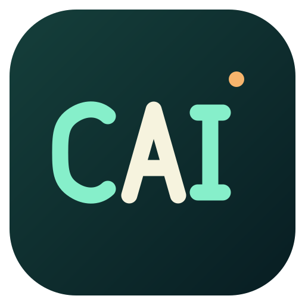

# CAI.Tools

<div align="center">



**本地免登录的应用启动器与插件平台**

_基于 [ZTools](https://github.com/ZToolsCenter/ZTools) 的本地版分支 | 当前版本 3.2.0-local.17_

[](https://github.com/Caicy/CAI.Tools/releases)
[](./LICENSE)
[](https://github.com/Caicy/CAI.Tools)

[English](./README.md) | 简体中文

</div>

## ✨ 特性

- 🚀 **快速启动** - 拼音搜索、正则匹配、历史记录、固定应用
- 🧩 **插件系统** - 支持 UI 插件和无界面插件，完整的 API 支持
- 📋 **剪贴板管理** - 历史记录、搜索、图片支持、跨平台原生实现
- 🖱️ **超级面板** - 鼠标中键或长按右键唤起，自动识别剪贴板内容
- 🎈 **悬浮球** - 置顶小圆球，单击或双击触发
- 🌐 **离线翻译** - Bergamot WASM + Firefox 翻译模型，无需联网
- 🤖 **AI 集成** - 自配 OpenAI 兼容供应商，支持插件流式对话
- 🔌 **MCP 服务** - 以 JSON-RPC 暴露插件工具，默认关闭，端口 36579
- 🛰️ **HTTP API** - 供外部程序调用应用功能与启动插件，默认关闭，端口 36578
- 🌍 **浏览器自动化** - ZBrowser 窗口池，每个插件独立 Session
- 🪟 **分离窗口** - 将插件独立为窗口，支持自定义尺寸
- 🔎 **网页快开** - 可配置的搜索引擎与搜索重定向
- 🎨 **主题定制** - 系统/亮色/暗色模式，5 种预设主题色并支持自定义颜色
- ⚡ **高性能** - LMDB 数据库、WebContentsView 架构、极速响应
- 🔒 **数据隔离** - 插件数据独立命名空间存储，安全可靠
- 🛠️ **开发友好** - 完整的 TypeScript 类型支持、热重载、Vitest 与 Playwright E2E

## 📸 预览

<div align="center">
  
  <p><i>快速启动应用和搜索功能演示</i></p>
</div>

### 界面展示

<div align="center">
  <table>
    <tr>
      <td width="50%">
        
        <p align="center"><i>主界面 - 亮色主题</i></p>
      </td>
      <td width="50%">
        
        <p align="center"><i>主界面 - 暗色主题</i></p>
      </td>
    </tr>
    <tr>
      <td width="50%">
        
        <p align="center"><i>设置界面 - 主题定制和通用设置</i></p>
      </td>
      <td width="50%">
        
        <p align="center"><i>插件市场 - 匿名浏览与安装插件</i></p>
      </td>
    </tr>
  </table>
</div>

## 🔒 本地版边界

CAI.Tools 是免登录的本地版本。启动链不加载官方账号、支付与云同步模块，相关兼容入口会明确返回 `OFFICIAL_CAPABILITY_UNAVAILABLE`，而不是静默失败。

| 能力           | 本地版状态                                                                     |
| -------------- | ------------------------------------------------------------------------------ |
| 官方账号与登录 | 不提供；`getUser` 返回 `null`                                                  |
| 支付与支付记录 | 不提供；调用返回明确失败                                                       |
| 官方云同步     | 不提供；活动心跳与同步模块已从启动链移除                                       |
| 插件市场       | 匿名访问，请求不携带 `Authorization`；依赖账号的操作在联网前失败               |
| AI 能力        | 仅使用自配供应商；官方 AI 查询返回明确失败                                     |
| 版本更新       | 手动检查上游 GitHub Release，自动检查恒关闭，不下载或安装更新包                |
| 插件兼容版本   | 插件 API 返回上游基线 `3.2.0`，应用与设置页显示完整本地版本号 `3.2.0-local.17` |

### 数据目录

默认数据根为 `~/.cai-tools`，可用环境变量 `ZTOOLS_DATA_ROOT` 显式覆盖；不会探测或导入原版 `.ztools` 用户数据。

- 设备库：`<root>/lmdb/device`
- 默认账户库：`<root>/lmdb/accounts/default`
- 命名空间：`ZTOOLS/`（主程序）、`PLUGIN/{name}/`（插件自动隔离）

### Git 镜像

Git 镜像协议、插件数据投影与 AI 凭据隔离已落地：插件数据通过显式投影适配器导出，AI 凭据始终保留在设备本地。**自动同步与多机迁移尚未完成**，协议实现不等于完整的同步流程。

## 🧰 内置插件

内置插件随应用打包，位于 `internal-plugins/`。随包内置不等于拥有内部 API 特权，授权名单以 `src/main/core/internalPlugins.ts` 为准。

| 插件           | 说明                                                                                                                                                                |
| -------------- | ------------------------------------------------------------------------------------------------------------------------------------------------------------------- |
| `setting`      | 应用设置界面，独立 Vue 项目（Vite + UnoCSS）                                                                                                                        |
| `system`       | 系统工具                                                                                                                                                            |
| `string-tools` | 字符串处理，离线文本工作台：SQL IN 拼接、大小写与命名转换、Unicode 双向转换、行整理去重。不保存输入历史，详见其 [README](./internal-plugins/string-tools/README.md) |

## 🚀 快速开始

### 安装

#### 方式 1：下载预编译版本（推荐）

从 [Releases](https://github.com/Caicy/CAI.Tools/releases) 页面下载 Windows x64 本地版：

- `CAI.Tools-x.x.x-win-x64-setup.exe` - NSIS 安装包
- `CAI.Tools-x.x.x-win-x64.zip` - 免安装压缩包
- `SHA256SUMS.txt` - 校验文件

macOS 与 Linux 暂无预编译产物，请从源码构建。

#### 方式 2：从源码构建

```bash
# 克隆仓库（包含子模块）
git clone https://github.com/Caicy/CAI.Tools.git --recurse-submodules
cd CAI.Tools

# 安装依赖
pnpm install

# 开发模式
pnpm dev

# 构建
pnpm build:win       # Windows
pnpm build:mac       # macOS（当前主机架构）
pnpm build:linux     # Linux（当前主机架构）
```

### 使用

1. 启动应用后，使用快捷键 `Alt+Z`（Windows）或 `Option+Z`（macOS）唤起主界面，可在设置中修改
2. 输入应用名称或命令进行搜索，支持拼音
3. 按 `↑` `↓` `←` `→` 选择，`Enter` 确认，`Esc` 退出

## 🧩 插件开发

CAI.Tools 沿用 ZTools 的插件体系，通过简单的配置、丰富的 API 以及跨平台支持开发插件。

**插件系统特点**：

- 📝 **简单配置** - 通过标准的 `plugin.json` 文件定义插件，无需复杂设置
- 🔌 **丰富的 API** - 通过全局 `ztools` 对象访问系统能力，包括通知、模拟输入、持久化存储、剪贴板、截图与 AI 对话
- 🎯 **灵活的指令** - 支持字符串、`regex`、`over`、`img`、`files`、`window` 六种匹配类型
- 📦 **两种分发形态** - 生产使用 ZPX（gzip asar），开发使用本地目录或 HTTP URL
- 🔐 **权限分离** - `window.ztools.internal` 仅对授权插件开放，内置插件不自动获得该特权
- 🌍 **跨平台** - 一次构建，在 Windows、macOS 和 Linux 上运行

插件 API 类型定义在 [ztools-api-types](https://github.com/ZToolsCenter/ztools-api-types) 子模块中维护。

> 📖 **上游文档**：[ZTools 开发者文档](https://ztoolscenter.github.io/ZTools-doc/)。本地版差异以 [AGENTS.md](./AGENTS.md) 为准。

## 🛠️ 技术栈

- **框架**: Electron 41 + Vue 3 + TypeScript
- **构建**: Vite + electron-vite + electron-builder
- **数据库**: LMDB（高性能键值存储，按设备/账户路由）
- **状态管理**: Pinia
- **搜索引擎**: Fuse.js + pinyin-pro（拼音支持）
- **翻译**: Bergamot WASM + Firefox 翻译模型
- **原生模块**: C++ (Node-API)
  - 剪贴板监听、窗口管理、区域截图、取色、鼠标监听
- **输入监听**: uiohook-napi（双击修饰键检测）
- **测试**: Vitest（单元）+ Playwright Electron（E2E）

## 📁 项目结构

```
CAI.Tools/
├── src/
│   ├── main/                    # 主进程
│   │   ├── index.ts             # 应用入口、单例锁、运行时兼容性检查
│   │   ├── appMain.ts           # 本地版启动、窗口与 API 初始化
│   │   ├── managers/            # 窗口、插件、剪贴板、代理、装配协调
│   │   ├── api/                 # IPC API（shared / renderer / plugin）
│   │   ├── core/                # 核心能力
│   │   │   ├── appData/         # 本地版数据布局与隔离路径
│   │   │   ├── lmdb/            # 数据持久化与存储路由
│   │   │   ├── gitMirror/       # Git 镜像协议与插件投影
│   │   │   ├── zbrowser/        # 浏览器自动化
│   │   │   ├── mcpServer.ts     # MCP JSON-RPC 服务
│   │   │   └── httpServer.ts    # HTTP API 服务
│   │   └── utils/
│   ├── preload/                 # 主程序 preload（contextBridge）
│   ├── renderer/                # 渲染进程（Vue）
│   └── shared/                  # 主进程与渲染进程共享类型
├── resources/
│   ├── lib/                     # 原生模块（.node）
│   └── preload.js               # 插件 preload（不经过 Vite 构建）
├── internal-plugins/            # 内置插件（setting / system / string-tools）
├── ztools-api-types/            # 插件 API 类型定义子模块
├── ztools-plugin-cli/           # 插件开发 CLI 子模块
├── docs/                        # HTTP API、Provider 开发、同步实现等文档
├── tests/                       # Vitest 单元测试与 Playwright E2E
├── scripts/                     # 构建与发布脚本
└── AGENTS.md                    # 开发规范与技术文档
```

## 📚 文档

- [AGENTS.md](./AGENTS.md) - 开发规范、架构说明、IPC 体系与 API 指南
- [CONTRIBUTING.md](./CONTRIBUTING.md) - 贡献流程与提交规范
- [changelog.md](./changelog.md) - 版本变更记录
- [docs/http-api.md](./docs/http-api.md) - HTTP API 接口说明
- [docs/provider-development-guide.md](./docs/provider-development-guide.md) - AI Provider 开发指南
- [internal-plugins/string-tools/README.md](./internal-plugins/string-tools/README.md) - 字符串处理插件说明

## 💻 开发

### 环境要求

- Node.js >= 22（CI 使用 22）
- pnpm 11（CI 使用 11.18.0）
- macOS、Windows 或 Linux 开发环境

### 代码拉取

1. 先 fork 仓库
   - 如需贡献插件类型或 CLI，请同时 fork [ztools-api-types](https://github.com/ZToolsCenter/ztools-api-types) 和 [ztools-plugin-cli](https://github.com/ZToolsCenter/ztools-plugin-cli)
2. 拉取完整代码（含子模块）

```bash
git clone https://github.com/Caicy/CAI.Tools.git --recurse-submodules
```

### 开发命令

```bash
# 安装依赖
pnpm install

# 开发模式（主进程 + setting 内置插件并行热重载）
pnpm dev
pnpm dev:main         # 仅主进程
pnpm dev:setting      # 仅 setting 插件开发服务器

# 类型检查
pnpm typecheck        # 全部
pnpm typecheck:node   # 主进程 + preload
pnpm typecheck:web    # 渲染进程

# 代码质量
pnpm format           # Prettier 格式化
pnpm lint             # ESLint 检查

# 测试
pnpm test             # Vitest 单元测试
pnpm test:watch       # 观察模式
pnpm test:e2e         # 源码 Electron E2E（不打包）

# 构建
pnpm build            # 仅编译源码（含类型检查与 setting 构建）
pnpm build:win        # 打包 Windows 应用
pnpm build:mac        # 打包 macOS 应用
pnpm build:linux      # 打包 Linux 应用（当前主机架构）
pnpm build:unpack     # 打包但不生成安装包（调试用）

# 子模块
pnpm sync-api-types   # 同步 ztools-api-types 类型
```

### 测试约定

- E2E 使用源码 Electron 启动，不需要为测试打包应用，也不要执行 `electron-builder` 或 `pnpm build:unpack`
- Playwright 会自动启动 setting 插件开发服务器（`127.0.0.1:15177`）和隔离的 Electron 实例
- 测试使用临时数据目录，不得读写真实的 `~/.cai-tools` 或 `~/.ztools`
- Electron E2E 使用自带 Chromium，不需要执行 `playwright install chromium`
- 截图与 trace 输出到 `test-results/playwright`，该目录不提交版本库

### 调试

- 主进程：在 VS Code 中按 F5，或使用 `pnpm dev` 查看终端日志
- 渲染进程：在应用中按 `Ctrl+Shift+I`（Windows）或 `Cmd+Option+I`（macOS）打开开发者工具
- 插件：在插件页面点击"打开开发者工具"按钮；正式闭源插件禁止打开

## 🗺️ 路线图

### 已完成 ✅

- [x] 应用快速启动与拼音搜索
- [x] 插件系统（UI + 无界面）与插件市场匿名访问
- [x] 剪贴板历史管理
- [x] LMDB 数据库与命名空间隔离
- [x] 主题定制、全局快捷键自定义
- [x] 插件分离为独立窗口
- [x] 超级面板、悬浮球、网页快开
- [x] 离线翻译（Bergamot WASM）
- [x] MCP 服务与 HTTP API
- [x] ZBrowser 浏览器自动化
- [x] 自配 AI 供应商与插件 AI 对话
- [x] 免登录本地版：移除官方账号、支付、云同步启动链
- [x] 独立数据根 `.cai-tools`，拒绝原版数据探测与导入
- [x] 手动上游版本提醒
- [x] Git 镜像协议、插件数据投影与 AI 凭据隔离
- [x] 内置字符串处理插件

### 进行中 / 未完成 🚧

- [ ] Git 自动同步与多机迁移
- [ ] macOS 与 Linux 预编译产物
- [ ] 插件自动更新
- [ ] 完整设置页面类型检查（现存 22 项上游基线错误）

### 明确不提供 ⛔

- 官方账号登录、支付、官方云同步（本地版边界，见上文）

## 🐛 问题反馈

遇到问题？请在 [Issues](https://github.com/Caicy/CAI.Tools/issues) 中反馈。

提交 Issue 时请包含：

- 操作系统版本
- CAI.Tools 版本（设置页或 `package.json`）
- 复现步骤
- 错误日志（如有）

上游 ZTools 的通用问题请提交到 [ZToolsCenter/ZTools](https://github.com/ZToolsCenter/ZTools/issues)。

## 📄 许可证

本项目采用 [MIT License](./LICENSE) 许可证。

## 💝 致谢

- [ZTools](https://github.com/ZToolsCenter/ZTools) - 上游项目，CAI.Tools 基于其代码
- [uTools](https://u.tools/) - 灵感来源
- [Electron](https://www.electronjs.org/) - 跨平台桌面应用框架
- [Vue.js](https://vuejs.org/) - 渐进式 JavaScript 框架
- [LMDB](http://www.lmdb.tech/) - 高性能嵌入式数据库
- [Bergamot](https://github.com/browsermt/bergamot-translator) - 离线翻译引擎
