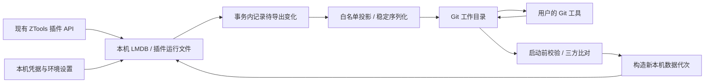

# CAI.Tools：免官方账号与 Git 文件同步设计

开始日期：2026-10-14；整理完成：2026-10-15。状态：用户已确认需求；本文是具体设计与实施交接，功能尚未实现。

## 1. 用户已确认的需求

| 编号 | 要求                                                                                           |
| ---- | ---------------------------------------------------------------------------------------------- |
| R01  | 个人多台 Windows 电脑使用，打开即可独立工作，无需注册、登录或本地账户密码。                    |
| R02  | 移除官方登录、官方云同步、需要官方账号的互动入口；保留可匿名访问的插件下载安装、主动插件更新。 |
| R03  | Git 提交、推送、拉取和冲突处理由用户的外部工具完成。                                           |
| R04  | 应用自动维护可供 Git 管理的文件目录，拉取后重启生效，无需手动导出和还原。                      |
| R05  | 同步插件程序与版本，以及已适配插件的配置、笔记、收藏等内容；未适配插件仍可使用，数据留本机。   |
| R06  | 通用偏好跟随用户；本机路径、窗口位置、开机启动等环境设置各机独立。                             |
| R07  | 配置中的 API 密钥、访问令牌等凭据留本机，不进入同步目录。                                      |
| R08  | 各机都能修改；冲突时提示并保留本机数据，在外部 Git 工具解决。                                  |
| R09  | 允许运行中执行 Git 拉取；发现外部变化后暂停目录写入、提示重启，用户先重启再继续编辑。          |
| R10  | 主程序主动检查上游新版本，只提供提醒；合并上游源码后重新构建改造版。                           |
| R11  | 第一版全新开始，可从 Git 同步目录加载；不迁移旧版真实用户数据。                                |
| R12  | 插件兼容调查来源为 ZToolsCenter/ZTools-plugins；局域网配对、设备组和跨电脑剪贴板暂缓。         |

## 2. 已核实的事实与证据边界

- 本地主程序基线：`6c9dee8c998ed7b4e6d0a80ad4311d3d8d24f72c`，`package.json` 版本 `3.2.0`。
- 当前环境实际读回：Git 2.55.0.windows.4、Node 22.19.0、pnpm 11.18.0；根/设置插件的依赖均未安装，两个 Git 子模块均未初始化。pnpm 实际警告 package.json 中的 pnpm.onlyBuiltDependencies 已被忽略。计划 A 的 A0 先处理这些准备项；本轮没有安装依赖或运行产品测试。
- `src/main/index.ts` 直接动态加载 `appMain.ts`，没有启动登录门禁；`storageManager.ts` 已有未登录的 default 空间。
- `src/main/appMain.ts` 会启动官方活动心跳；`src/main/api/updater.ts` 默认开启自动检查，并初始化能下载安装原版的更新器。
- `src/main/core/storage/storageRouter.ts` 当前只转发 account DB 事件；`syncApi.ts` 只为部分前缀发 change 事件。Git 同步不能仅监听现有 change 事件，否则会漏掉设备库中的通用设置。
- 插件程序导出已有实现：`src/main/api/renderer/pluginInstaller.ts:exportAllPlugins()`；单条 JSON 导出已有实现：`src/main/api/plugin/internal.ts`。未找到通用完整备份还原入口。
- 主程序配置主要通过 `DatabaseAPI.dbPut/dbGet` 保存为 `ZTOOLS/<key>` 文档；通用设置页使用 `ZTOOLS/settings-general`，不能仅导出旧云同步白名单里的 `ZTOOLS/user-settings`。
- 插件调查基线：`e4962a0a44d2cc50bdb1c2f85577e8525e6bf040`，通过只读 `git ls-remote` 获取。
- 2026-10-14 匿名访问以下两个接口，均返回 HTTP 200：
  - `https://z-tools.top/api/market/plugins/latest?name=code-snippets&platform=win32`：available=true、版本 1.2.0。
  - `https://z-tools.top/api/market/plugins/download?name=code-snippets`：含 downloadUrl 和 zpxDownloadUrl。
    仅验证接口与返回内容；没有下载、安装或执行该插件，也没有验证全市场、付费插件或网络故障行为。
- [代码模板 1.2.0 的源码](https://github.com/ZToolsCenter/ZTools-plugins/blob/e4962a0a44d2cc50bdb1c2f85577e8525e6bf040/plugins/code-snippets/src/Snippets/index.vue)：`tpl_` 文档保存代码模板；每次复制也会改变 usageCount、updatedAt。
- [AI 助手 1.2.1 的源码](https://github.com/ZToolsCenter/ZTools-plugins/blob/e4962a0a44d2cc50bdb1c2f85577e8525e6bf040/plugins/ai-helper/src/useChat.ts)：`conv/<id>` 文档的 data 字段为序列化会话，模型选择使用 dbStorage。
- [2FA 插件源码](https://github.com/ZToolsCenter/ZTools-plugins/blob/main/plugins/otp-2fa/src/composables/useAuth.ts)：普通插件数据库文档中包含密钥材料和设备绑定配置。因此默认导出全部 `PLUGIN/` 不符合 R07。

上述为源码检查和两个匿名 HTTP 接口的实际访问结果。本文的导入、并发保护、恢复和插件适配均需实施后验证。

## 3. 交付拆分与方案入口

1. [计划 A：免登录本地版](./2026-10-14-cai-tools-local-edition-plan.md)。独立交付：本机启动、插件运行、匿名市场、主动更新提醒。
2. [计划 B：Git 同步目录](./2026-10-14-cai-tools-git-mirror-plan.md)。依赖 A：文件化状态、插件适配、自动导出、运行中拉取保护和启动恢复。

这是两个可分别验收的阶段，不在计划 A 中提前引入 Git 运行时依赖。当前会话只新增方案文档。

## 4. 核心结构



保留 LMDB 和现有 `window.ztools` 接口，避免要求所有插件改用新存储 API。Git 目录是可迁移状态的文件化表示，运行数据库只在本机。

建议产品标识暂用 `CAI.Tools`、Windows App ID `tools.cai.local`，默认数据根为 `%USERPROFILE%\.cai-tools`。这是隔离实现选择；不自动读取或写入 `%USERPROFILE%\.ztools`。保留现有测试用 `ZTOOLS_DATA_ROOT` 与 `ZTOOLS_LEGACY_USER_DATA_PATH` 显式覆盖能力。

本机根目录：

```text
.cai-tools/
  profile-settings.json       # Git 目录路径等本机设置
  active-generation.json     # 唯一生效代次指针
  generations/<id>/
    lmdb/device/             # 本机设置和凭据
    lmdb/accounts/default/   # 单一 default 业务空间，保留现有 API 路由兼容
    plugins/                 # 实际运行插件；绝对路径只在本机注册表保存
    plugins-data/            # 插件外部文件，未适配内容只保留本机
  artifacts/<sha256>.zpx     # 安装时保存的原始程序包
  git-state/                 # 基线、外部版本证据、冲突材料和协调状态
  clipboard/ logs/ temp/     # 本机运行数据
```

同步目录由用户在设置中选择已有本地 Git 工作目录；不要求凭据，不代为克隆或认证。初始化空工作目录时创建稳定 profile.json；已有有效快照时只加载，不先导出空数据库覆盖它。

## 5. Git 文件格式

```text
sync-root/
  .gitignore
  .gitattributes
  profile.json
  host/preferences.json
  host/plugin-shortcuts/<id-hash>.json
  plugins/<plugin-name>.json
  records/<plugin-name>/<logical-id-sha256>.json
  blobs/<content-sha256>
  packages/<plugin-name>/<artifact-sha256>.zpx
```

- profile.json：`format="cai-tools-profile"`、schemaVersion=1、profileId。首次创建一次，不写设备名、当前时间、绝对路径。
- 一条逻辑记录一个 JSON 文件；稳定排序对象键、UTF-8、LF、末尾换行。没有业务变化就不改文件。
- 记录：`schemaVersion, plugin, adapter, key, deleted, payload`。`key` 是插件内部逻辑 ID，文件名是它的 SHA-256，避免路径穿越、Windows 保留名称和长度问题。
- 元信息 `_rev`、cloud checkpoint、设备 ID 不共享；导入时根据目标库生成本机 revision。
- 应用删除记录写 `deleted=true,payload=null` 的明确 tombstone。文件意外缺失、损坏或插件版本不支持时不推断为删除；如果记录原本确实存在于已接受的 Git 基线提交中，而新提交明确移除了它，可按基线身份构造逻辑删除，支持用户在外部 Git 工具回退历史版本。未提交的缺文件不能作为这个证据。
- 附件按 SHA-256 保存；记录内声明长度、MIME 和摘要，导入前验证实际二进制。首批两个适配器的文本和 base64 图片内容可在文档限额内同步；后续独立附件适配同样使用此协议。
- 插件描述符记录 `name, version, installed, packagePath, sha256, platform`；路径相对且只允许 win32。使用安装时保存的原始包，不把运行目录、开发工程、node_modules、Session、缓存当程序包导出。
- 用户在某台卸载插件时，描述符 installed=false，其他电脑重启后停止使用该插件；插件数据由其自身明确删除动作产生 tombstone，卸载不自动删除各机未适配数据和凭据。
- `.gitignore` 排除临时发布文件；LMDB、账号凭据、同步目录的本机路径、冲突备份从一开始就在本机根目录，不依赖 .gitignore 来隐藏秘密。
- `.gitattributes` 固定受管 JSON 为 LF，并将 packages/blobs 标记为二进制；只增加协议目录的规则，保留用户已有规则。JSON 内容比较使用规范化投影，换行/格式变化不误判为业务变化。

Git 二进制包会增加仓库体积，这是选择直接同步程序包的代价。第一版不自动启用 Git LFS，也不增加远端存储服务。

## 6. 数据与凭据投影

### 宿主

- `ZTOOLS/settings-general` 只导出声明字段：theme、primaryColor、customColor、placeholder、searchMode、showRecentInSearch、showMatchRecommendation、recentRows、pinnedRows、hotkey、autoPaste、autoClear、autoBackToSearch、hideMainWindowOnPluginEsc、spaceOpenCommand。
- 全局快捷键仅同步目标为已安装插件 canonical `pluginName/command` 的记录；本机应用路径目标、内置环境指令留本机。按快捷键稳定 ID 拆为独立记录，导入后原有注册器校验占用；失败只提示，不影响启动。
- 开机启动、窗口位置和尺寸、GPU、代理、本机终端、扫描结果、缓存、Session 和本机应用启动项留本机。
- AI 提供商可以同步无凭据的名称、地址、API 格式和模型描述；密钥按稳定 provider ID 存在设备文档 `ZTOOLS/local-ai-provider-credentials`。地址含 username/password 或 query 时保持该地址本机化，不能把 URL 中的鉴权参数作为普通地址导出。接收新 provider 但无本机密钥时显示“需要在本机配置密钥”，不回退官方 AI。

### 插件

- registry 按插件名、确切版本、适配器版本匹配，默认拒绝未知文档和未知字段。版本不匹配即暂停该插件数据导出，保留原记录与本机内容。
- 第一批：code-snippets 1.2.0 和 ai-helper 1.2.1。二者必须分别完成真实插件读写和双实例恢复验证，才在 UI 标为“已适配”。
- code-snippets：模板内容、标签、置顶和创建时间可同步；usageCount 与复制带动的 updatedAt 留本机，避免复制行为制造同步冲突。导入时合并本机统计字段。
- ai-helper：将 data 中的会话 JSON 转为结构化 payload；只接受已核对的 Conversation / Message 字段；原样保留正文、图片和推理内容。模型选择属于可选已声明配置，不能随意导出全部 dbStorage。
- 2FA、密码管理、远程连接和凭据类插件默认程序可用、数据不导出。其他插件从适配注册表逐步加入，不给用户“通用字段猜测就已排除所有秘密”的保证。
- 非 LMDB 数据（例如插件通过 fs、自建 SQLite、localStorage、IndexedDB 写入的数据）不自动纳入；有专用、经过验证的适配器时才可同步。

R07 约束的是配置凭据与插件结构中的密钥材料。用户主动写进笔记或代码正文的字符串会作为正文同步；第一版不能自动判断每段自由文本是不是秘密。UI 在开启内容同步时明确这一边界。

## 7. 自动导出与运行中 Git 拉取

### 修改持久化

在底层 LMDB 的 put、remove、附件增删事务内，为已声明同步对象写本机 dirty journal。不能在异步 change 回调中才记账；崩溃可能发生在数据已保存、回调未运行之间。

journal 记录逻辑键、操作、最新内容摘要、共享投影、导出序号；放在该数据所在 LMDB 的 meta 库保留命名空间中。存储业务数据与 journal 成功后才返回插件调用结果。导入新代次时显式抑制此 journal，避免导入循环。

导出器去抖 500ms，最多延迟 2s；排队串行执行，保持插件原同步 API 返回方式。写入前验证目标仍等于自己最后导出的内容、仓库状态未变化，临时文件 flush 后发布。相同内容不写。

### 外部变化保护

- 状态：unconfigured、ready、waiting-for-git、external-change、conflict、invalid、unavailable。
- index.lock 或活动 Git 操作先进入 waiting-for-git，暂缓导出。锁解除后稳定比较同步内容：若只是 add/commit 且内容仍等于本机最后发布值，更新 HEAD 基线并回到 ready；只有外部同步内容确实改变才进入 external-change 并提示重启。自己发布文件产生的 watcher 事件用内容与 serial 判定，不能按时间窗口粗略忽略。
- 应用允许只读调用系统 Git：rev-parse、status、ls-files、show。用户仍掌管全部修改型 Git 操作。以 argument 数组启动进程，无 shell 拼接，repoPath 不插入命令文本。禁用 optional locks 和 fsmonitor，仅允许固定参数形式；状态查询不改索引、不调用用户配置的 fsmonitor 程序。
- 每次导出后将本机投影和已导出摘要存入本机基线。检测外部变化时保存外部文件副本；Git HEAD 中的已提交对象是恢复拉取内容的额外证据。
- watcher、index.lock 检查和 rename 前 hash 校验都只能缩小竞态窗口，不能宣称能阻止任意外部 Git 进程。即使外部拉取覆盖了刚导出的文件，本机 LMDB 与 journal 仍保存修改；启动时对照 base、local、incoming 发现差异并停在冲突状态。
- 外部目录变化后的晚到写入也记入本机 journal；绝不只清空队列。用户已接受收到提示后重启再编辑，但实现仍处理正在结束的异步任务。
- 主动退出时，仅 ready 状态可 flush；其他状态保存 journal 后退出，不能把旧本机值覆盖回刚拉取的目录。
- 冲突材料写 `%USERPROFILE%\.cai-tools\git-state\conflicts/<id>/base.json,local.json,incoming.json`。UI 提供打开位置；用户在外部 diff/Git 工具修正工作目录。结构正确但尚未解决本机差异时要求用户的修正内容与选定版本明确对应，不能用“文件能解析”代替冲突已解决。

### 三方规则（每个逻辑对象）

| base/local/incoming | 处理                                     |
| ------------------- | ---------------------------------------- |
| local == incoming   | 一致，不产生写入。                       |
| local == base       | 采用 incoming。                          |
| incoming == base    | 保留 local，并在启动成功后重新导出。     |
| 三者均不同          | 保存三份材料，保留原代次，提示外部处理。 |

比较包含 tombstone，不能用时间戳决定胜者；不同文件可独立合并，同一个对象第一版不自动做字段级业务合并。

## 8. 启动导入、恢复与 Git 外部依赖

先取得单实例锁，再运行不导入业务 singleton 的启动准备器，然后动态加载 appMain。启动准备器可以使用低层 LmdbDatabase，但不能导入 lmdbInstance、APIManager、ClipboardManager、pluginManager。

1. 固定 repoPath，解析 worktree 的真实 gitDir/commonDir，拒绝活动 index.lock、未解决冲突、未知格式。
2. 对目录做两次稳定读取，并记录 HEAD / tracked files；JSON 冲突标记、重复键、缺少包或引用附件、版本不支持均拒绝。
3. 投影当前本机数据，与基线及 incoming 三方比对。已有配置的设备若目录为空，保留本机并报错；全新机器遇空目录才初始化快照。
4. 在新的 generation 复制本机 DB 和运行文件，保留凭据、本机环境配置与未适配数据；复制前关闭离线读取器，禁止复制仍打开的 LMDB 文件作为一致性备份。
5. 在新代次导入已合并的共享内容，安装并验证原始插件包、重建本机绝对路径注册表。所有 DB put/remove 返回值和附件摘要必须成功。
6. 验证新代次，写入独立准备事务说明。最后原子替换 active-generation.json，单次切换整个 DB 与插件路径；旧代次保留用于回退。
7. 关键 API 初始化完成后，在显示可交互窗口、启动用户插件之前标记新代次 accepted。此前失败按准备事务回退旧指针；accepted 之后的正常运行崩溃保留当前代次与 journal，不能回退丢掉用户的新修改。恢复完成后再继续本机工作。

默认保留最近 3 个已验证代次；清理必须在成功启动后且无回退事务时进行。目录移除、Git 不在 PATH、Git 命令超时、离线磁盘不可用只使同步不可用，本机使用仍可启动。设置页可指定 Git 可执行文件；应用采用标准只读命令，不持有 Git 托管平台凭据。

## 9. UI 的最小可见流程

“Git 同步目录”页只显示：选择目录、打开目录、同步状态、已同步插件与数据范围、需要重启提示、冲突位置、导出错误详情。后台正常导出不弹 toast；外部变化与错误只在状态变化时提醒。

无目录也能启动并使用所有本机能力。选择一个已有快照时，进入 external-change，提示重启；首次绑定既有本机数据与已有快照会做三方/首次基线检查，不静默覆盖任何一边。

插件市场匿名访问失败时提供重试和本地导入，不诱导注册登录。官方身份、短期 token、支付 API 保留明确不可用响应形状，使插件可检测能力；不伪造官方用户或授权。自配 AI / OCR / 翻译服务可按用户主动调用继续使用。

## 10. 验收与实际验证边界

验收清单和精确命令见两个实施计划。修改源码必须遵守根 AGENTS.md：新增/实质修改函数多行 JSDoc、每个参数 @param、@returns、主动抛错 @throws；关键准备、校验、发布、回滚、清理步骤有目的明确的注释。

必需证据包括：源码 Electron E2E、两个隔离 profile 与真实 Git 操作、故障注入下数据不丢、真实样本插件运行、未使用 ZTOOLS_E2E 的普通开发运行网络审计。计划中的预期结果不视为已通过。

所有测试使用临时数据根和旧数据目录；`pnpm test:e2e` 自动启动设置开发服务 127.0.0.1:15177。截图截取独立插件 WebContentsView 的可见区域，在正文稳定特征出现后进行。测试输出 test-results/playwright，不提交。E2E 不执行 electron-builder 或 build:unpack，不使用安装包。
